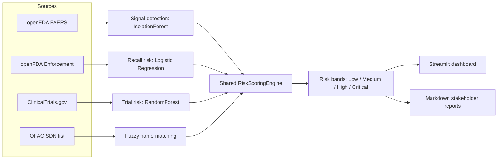
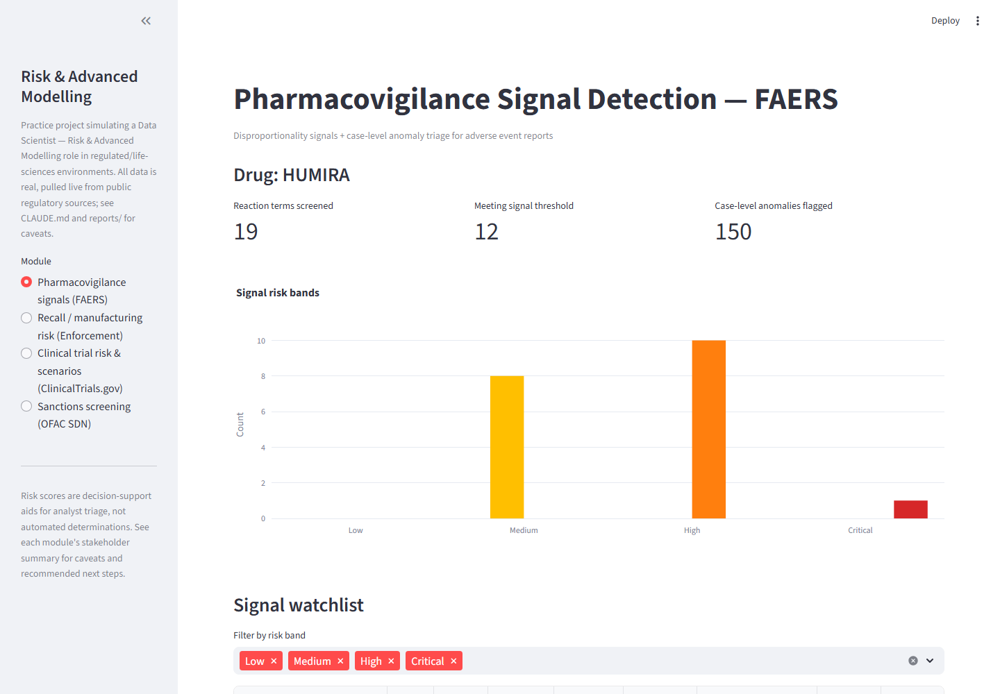
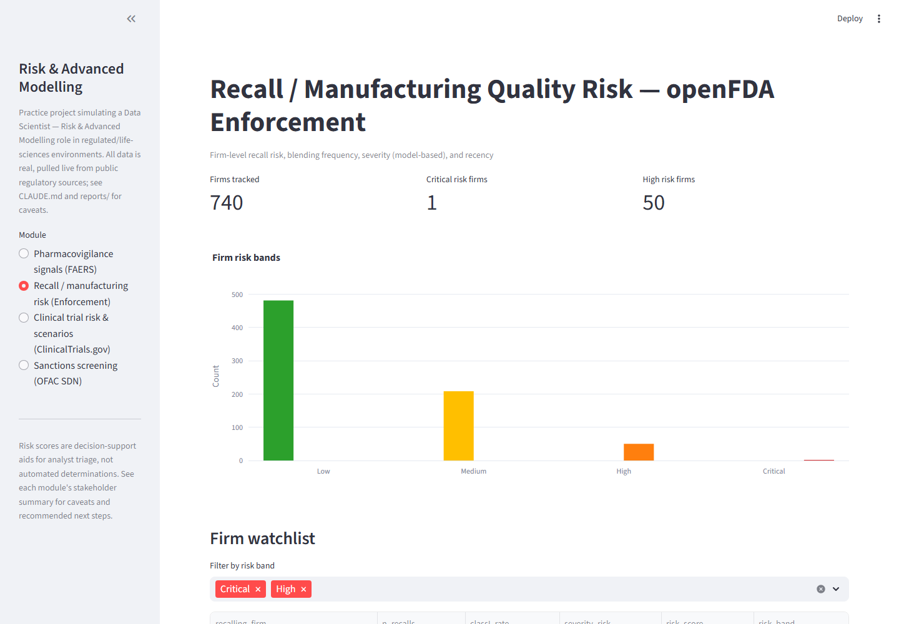
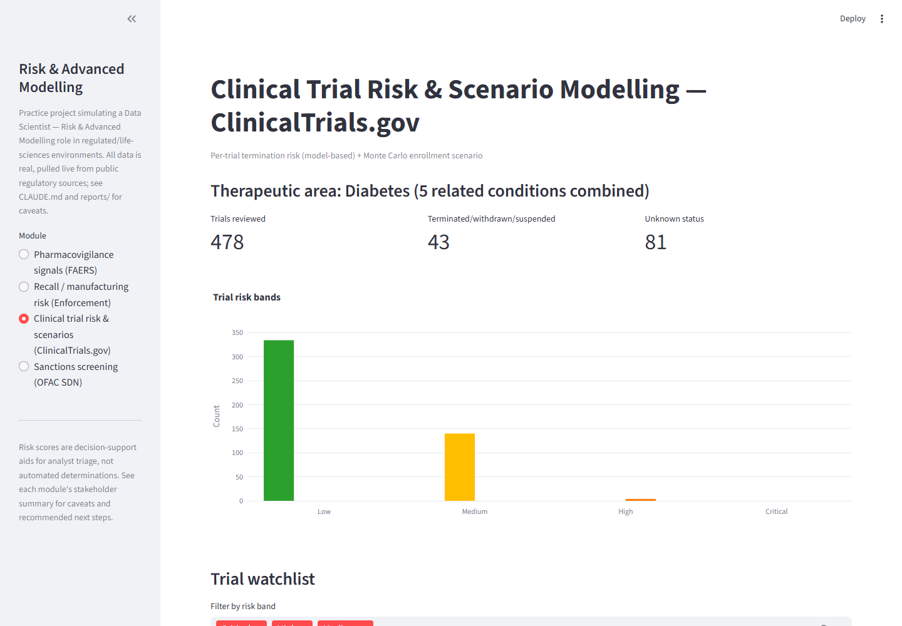
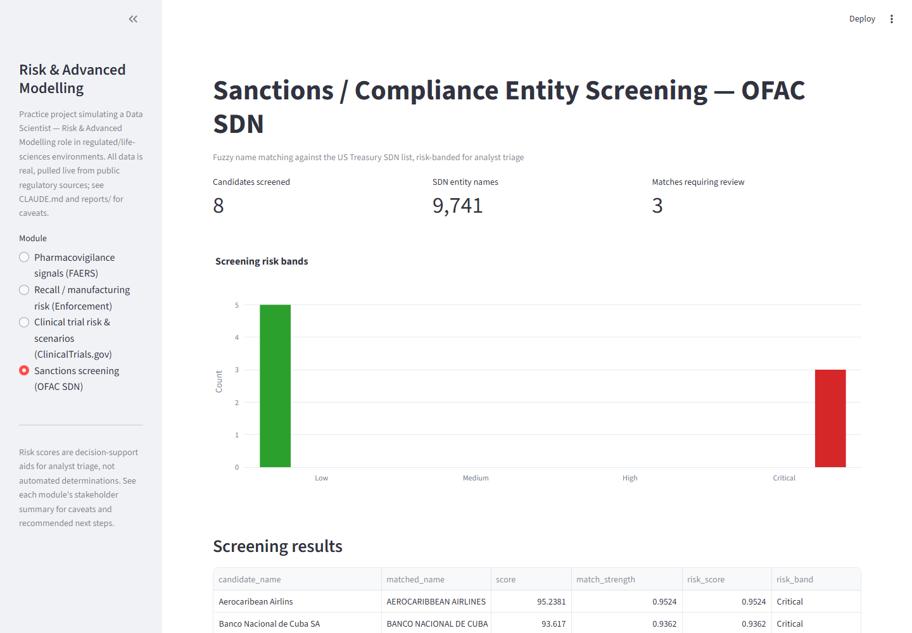

# Risk & Advanced Modelling

Four risk-analytics modules for a regulated, life-sciences-style setting. Each one pulls real, live data from a public regulatory source (openFDA, ClinicalTrials.gov, US Treasury OFAC), scores it with a shared risk-scoring engine, and writes both a Streamlit dashboard view and a stakeholder-facing markdown report.

I wanted to practice risk modelling the way it's actually done in a regulated environment: no synthetic toy data, cross-validated metrics instead of a single train/test split, and every model's limitations documented next to its results instead of left out.

Read [docs/CASE_STUDY.md](docs/CASE_STUDY.md) for the situation, approach, result, and recommendation behind each module. [CLAUDE.md](CLAUDE.md) has the underlying working brief.

## Architecture



Each module has its own notebook and its own model, but they all hand their output to the same `RiskScoringEngine` (`src/risk_framework/risk_scoring.py`), which combines named, normalized risk factors into one score and one of four risk bands. That's what keeps the scoring approach consistent across four otherwise unrelated data sources.

## Dashboard

```bash
streamlit run app/dashboard.py
```

| Pharmacovigilance signals (FAERS) | Recall / manufacturing risk (Enforcement) |
|---|---|
|  |  |

| Clinical trial risk & scenarios | Sanctions screening (OFAC) |
|---|---|
|  |  |

The dashboard reads pre-generated output from `data/processed/<module>/`. Run each notebook at least once first, since the final cells in each one write those processed files and the `reports/*.md` summaries.

## The four modules

| # | Module | Data source | Notebook |
|---|--------|-------------|----------|
| 1 | Pharmacovigilance signal detection | [openFDA FAERS](https://open.fda.gov/apis/drug/event/) | `notebooks/01_faers_signal_detection.ipynb` |
| 2 | Recall / manufacturing quality risk | [openFDA Enforcement](https://open.fda.gov/apis/drug/enforcement/) | `notebooks/02_enforcement_recall_risk.ipynb` |
| 3 | Clinical trial risk & scenario modelling | [ClinicalTrials.gov v2](https://clinicaltrials.gov/data-api/api) | `notebooks/03_clinicaltrials_risk.ipynb` |
| 4 | Sanctions / compliance entity screening | [OFAC SDN list](https://sanctionslistservice.ofac.treas.gov/) | `notebooks/04_ofac_screening.ipynb` |

All four notebooks have been run end to end against live data at least once. Run them in order; the first run fetches and caches data into `data/raw/<module>/`, later runs reuse the cache.

### What goes into a risk score

- **FAERS**: PRR/ROR signal strength, statistical confidence, and report volume.
- **Enforcement**: recall frequency and recency, plus a logistic regression model's predicted probability of a Class I recall.
- **Clinical trials**: a RandomForest model's predicted probability of termination/withdrawal/suspension, plus reporting-quality and trial-scale risk.
- **OFAC**: fuzzy match strength against the SDN list.

## Models and results

| Model | Type | Dataset | Cross-validated performance |
|---|---|---|---|
| `faers_case_anomaly_iforest.joblib` | IsolationForest (unsupervised) | 3,000 HUMIRA FAERS reports | 5% flagged at contamination=0.05, no ground truth to score against |
| `recall_severity_classifier.joblib` | Logistic Regression (TF-IDF + one-hot) | 3,000 openFDA recalls, 9.9% Class I | ROC-AUC 0.97 (5-fold stratified) |
| `clinical_trial_termination_classifier.joblib` | RandomForest | 455 trials across 5 diabetes conditions, 9.5% terminated/withdrawn/suspended | ROC-AUC 0.84 (5-fold stratified) |

Every classifier is evaluated with cross-validation rather than one train/test split, because the positive classes are small and a single split gave unstable, overly optimistic numbers depending on which rows landed in the test set. Each model ships a `.meta.json` sidecar recording its features, training date, and dataset size, and each notebook has a caveats section covering what the model doesn't handle well.

## Setup

```bash
python -m venv .venv
.venv\Scripts\activate        # Windows
pip install -r requirements.txt
```

## Project layout

```
app/                    Streamlit risk dashboard
src/data_connectors/     one module per external API
src/risk_framework/      shared risk-scoring components
src/utils/               HTTP fetch and caching, with pull metadata
data/raw/                cached raw API responses (gitignored)
data/processed/          cleaned data consumed by the dashboard
models/                  trained model artifacts (.joblib) + metadata
notebooks/               one notebook per module
reports/                 stakeholder-facing markdown summaries
tests/                   unit tests for src/risk_framework
docs/screenshots/        dashboard screenshots used in this README
```

## Testing

```bash
pytest
```

## Limitations and governance notes

This is a portfolio project, not a production system or a regulatory submission. All the data is real and pulled live, but:

- Risk scores are decision-support aids meant for analyst triage, not automated determinations. Every report and dashboard page says so explicitly.
- Some inputs, like the OFAC "vendor list" and the specific drug/therapeutic area chosen, are illustrative selections for this exercise rather than a real client's actual data, and that's flagged wherever it applies.
- Known caveats (class imbalance, small sample sizes, no ground truth for the unsupervised anomaly model) are documented in each `.meta.json` and notebook rather than smoothed over, at roughly the level of scrutiny this kind of work would get under real regulatory review.
